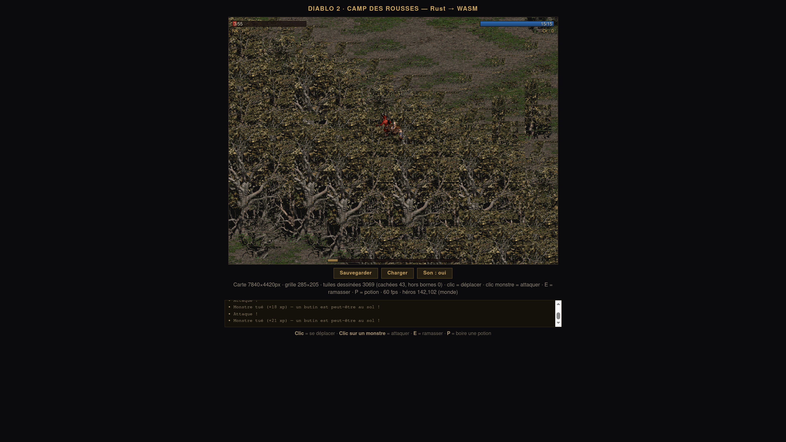

# diablo2-wasm — Diablo II en Rust/WebAssembly

Portage navigateur des **données** de Diablo II (v1.12) : lecteur MPQ, décodeurs de sprites
(DC6/DCC) et de cartes (DT1/DS1), moteur de jeu et gameplay — le tout en Rust compilé en
WebAssembly, décodé **côté client** depuis votre propre installation du jeu.

> ⚠️ **Aucun asset du jeu n'est distribué ici.** Tous les contenus (cartes, sprites, sons,
> tables) appartiennent à © Blizzard Entertainment. Le script d'extraction lit vos propres
> fichiers, en local, et n'envoie rien nulle part.



## Ce que sait faire ce dépôt

| Crate | Rôle | Vérification |
|---|---|---|
| `engine-rs/crates/d2mpq` | Lecteur MPQ v0/v1 (chiffrement StormLib, zlib, bzip2, PKWARE DCL) | 7/7 SHA-256 identiques à la référence Python |
| `engine-rs/crates/d2dcc` | Sprites animés DCC + composition COF multi-couches | rendus visuels validés |
| `engine-rs/crates/d2dc6` | Images DC6 (2 layouts, RLE avec clamp) | octet-identique au décodeur Python |
| `engine-rs/crates/d2map`*(proto)* | Tuiles DT1/DS1, rendu isométrique, collision | rendu du Camp des Rousses validé |
| `engine-rs/crates/d2rules` | Gameplay pur : FSM monstres, combat, drops, inventaire, XP, sauvegarde | 28 tests déterministes |
| `engine-rs/crates/d2game` | Moteur WASM : compositor, caméra, boucle, liaison d2rules | 60 fps sur la vraie carte |
| `engine-rs/crates/d2tool` | CLI d'extraction/probe/sha | — |
| `tools/*.py` | Vérité terrain Python (MPQ+crypto, PKWARE DCL port de blast.c, DC6) | sert de référence aux tests Rust |

Le jeu inclus : **menu titre** (logo et fond extraits des archives), **3 classes jouables**
(Barbare, Sorcière, Paladin — stats réelles de charstats.txt), carte du **Camp des Rousses**,
3 espèces de monstres avec IA, combat (formule officielle `200×TH/(TH+AC)`), drops,
inventaire, XP par la table officielle, sauvegarde/chargement, sons originaux.

## Build

```sh
# Prérequis : Rust (édition 2021) + la cible wasm
curl --proto '=https' --tlsv1.2 -sSf https://sh.rustup.rs | sh
rustup target add wasm32-unknown-unknown
cargo install wasm-bindgen-cli --version 0.2.129   # version épinglée par le projet

# Construire + tester
cd engine-rs
cargo test                      # toute la suite (les tests de fichiers réels s'auto-ignoreront)
cargo build --release --target wasm32-unknown-unknown -p d2game
wasm-bindgen --target web --out-dir ../demo/game-pkg \
    target/wasm32-unknown-unknown/release/d2game.wasm
```

## Extraire les actifs de VOTRE installation

```sh
cd tools
# release digitale (fichiers Installer Tome*.mpq) :
python3 extract_assets.py --tomes "/chemin/vers/le/dossier/des/tomes" --out ../demo/assets
# ou jeu installé (dossier contenant d2data.mpq, d2char.mpq, patch_d2.mpq…) :
python3 extract_assets.py --game "/chemin/vers/Diablo II" --out ../demo/assets
```

Le script extrait : palette, carte (DS1 + DT1), sprites des héros/monstres, sons — en les
sondant par hash (le `(listfile)` des MPQ de D2 est un appât volontairement corrompu par
Blizzard). **Limitation connue** : les chemins des sprites de personnages varient selon les
releases ; le script couvre la carte et la palette de façon fiable, et documente dans sa
sortie ce qui n'a pas été trouvé (les outils `tools/*.py` servent de base pour compléter).

## Jouer

```sh
cd demo
python3 -m http.server 8077
# puis : http://localhost:8077/menu.html
```

- **Clic** : se déplacer (A* sur la vraie grille de collision)
- **Clic sur un monstre** : attaquer · **E** : ramasser · **P** : boire une potion
- **Sauvegarder / Charger** : état exact (positions, vie, inventaire, or, XP)

## Documentation du reverse engineering

Les spécifications déduites (sans code du jeu, uniquement observation de fichiers) :
- [`specs/DC6-SPEC.md`](specs/DC6-SPEC.md) — sprites statiques (2 layouts)
- [`specs/DCC-SPEC.md`](specs/DCC-SPEC.md) — sprites animés, pièges palette BGR
- [`specs/MAP-SPEC.md`](specs/MAP-SPEC.md) — DT1/DS1, collision
- Découverte clé : le dispatch de décompression de Storm.dll v1.12 n'accepte que les
  masques 0x01/0x08/0x40/0x80 — **0x08 = PKWARE DCL**, pas bzip2 (la table moderne de
  StormLib est inapplicable aux MPQ de D2).

## Crédits & licences

- Code de ce dépôt : MIT.
- `specs/blast.c` : © Mark Adler (zlib license) — port de référence PKWARE DCL.
- `tools/blast_pkware.py` : port Python du même algorithme.
- **Diablo II et ses contenus sont la propriété de Blizzard Entertainment.** Ce projet est
  un travail d'interopérabilité/personal backup : utilisez uniquement des copies du jeu
  que vous possédez légitimement, et ne distribuez jamais les fichiers extraits.
